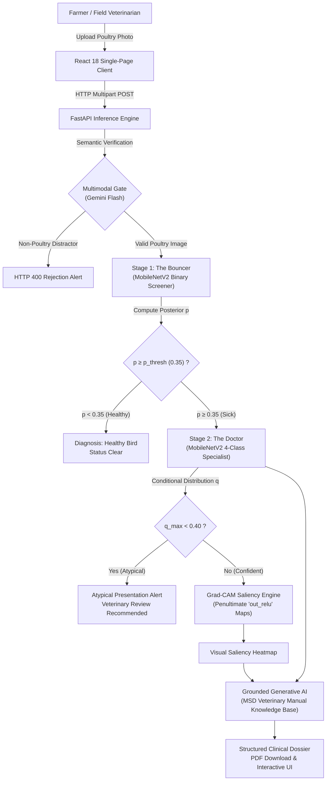

# PoultryHealth Intelligence: Hierarchical Deep Learning & Grounded Generative AI for Poultry Disease Diagnosis

[](https://www.python.org/)
[](https://fastapi.tiangolo.com/)
[](https://react.dev/)
[](https://www.tensorflow.org/)
[](https://vitejs.dev/)
[](https://opensource.org/licenses/MIT)

> **Official Repository** for the research paper:  
> *"PoultryHealth Intelligence: Hierarchical Deep Learning and Grounded Generative AI for Poultry Disease Diagnosis"*  
> **Authors:** Ayush M Singh, Venkata Sriram Topalli, Dr. Dega Nagaraju  
> **Affiliation:** School of Computer Science and Engineering (SCOPE), Vellore Institute of Technology (VIT), Vellore, India  

---

## 📖 Executive Summary

Avian disease outbreaks represent a critical threat to global poultry production, rural livelihoods, and antimicrobial stewardship. Conventional monolithic diagnostic classifiers balance errors symmetrically across all pathologies, failing to address the fundamental clinical asymmetry of veterinary epidemiology: **missing an actively shedding, contagious bird (false negative) risks flock-wide devastation, whereas flagging a healthy bird for inspection (false positive) incurs negligible operational cost.**

**PoultryHealth Intelligence** resolves this fundamental limitation by introducing a **decoupled, two-stage convolutional hierarchy** coupled with **visual interpretability (Grad-CAM)** and **grounded generative AI report synthesis**:

1. **Multimodal Input Gate (Gemini Flash)**: Filters non-poultry distractors (vehicles, domestic animals, farm machinery) via zero-shot semantic verification before invoking downstream convolutional models.
2. **The Bouncer (Screening Model $f_B$)**: A binary MobileNetV2 network optimizing a dedicated screening hyperplane ($AUC = 0.884$ [95% CI: 0.851–0.915]). By operating at a safety-first screening threshold ($p_{\text{thresh}} = 0.35$), sick-bird sensitivity surges to **92.2%** (261/279 detected), slashing false negatives by **56.9%** while preserving **71.2%** healthy specificity.
3. **The Doctor (Specialist Model $f_D$)**: A four-class MobileNetV2 network categorizing positive screening cases across four prevalent avian pathologies:
   - **Bumblefoot** (*Staphylococcus aureus*)
   - **Chronic Respiratory Disease (CRD)** (*Mycoplasma gallisepticum*)
   - **Fowl Pox** (*Avipoxvirus*)
   - **Infectious Coryza** (*Avibacterium paragallinarum*)
4. **Open-Set Abstention Protocol**: Flags low-confidence predictions ($q_{\max} < \tau_{\text{open}} = 0.40$) for mandatory veterinary consultation.
5. **Pathological Explainability (Grad-CAM)**: Generates class-discriminative saliency heatmaps overlaid on 224×224 input images to verify genuine anatomical lesion localization.
6. **Grounded Clinical Dossier Synthesis**: Automatically generates structured clinical reports grounded exclusively within approved **MSD Veterinary Manual** guidance to enforce strict antimicrobial stewardship and prevent OTC antibiotic self-administration.

---

## 🏛️ System Architecture



---

## 📊 Empirical Evaluation & Benchmarks

All models were evaluated on the exact same held-out validation cohort of **$N = 425$ images** (146 Healthy, 23 Bumblefoot, 137 CRD, 29 Fowl Pox, 90 Coryza):

### 1. Comparative Screening Benchmark ($N = 425$)
| Architecture / Model | Sickness Screening Accuracy | Sick Recall (Sensitivity) | Healthy Specificity | Binary Screening AUC-ROC | Inference Latency (CPU) |
| :--- | :---: | :---: | :---: | :---: | :---: |
| Flat MobileNetV2 (Argmax, $\theta = 0.50$) | 75.3% | 72.4% | 80.8% | 0.832 [0.793–0.869] | 78 ms |
| Flat ResNet-50 Baseline | 74.8% | 71.3% | 81.5% | 0.825 [0.785–0.862] | 185 ms |
| Flat DenseNet-121 Baseline | 76.2% | 73.8% | 80.8% | 0.839 [0.801–0.875] | 210 ms |
| Flat MobileNetV2 (Tuned, $\theta = 0.28$) | 79.3% | 92.2% | 54.8% | 0.832 [0.793–0.869] | 78 ms |
| **Proposed Bouncer (Default, $p = 0.50$)** | **82.1%** | **81.7%** | **82.9%** | **0.884 [0.851–0.915]** | **68 ms** |
| **Proposed Bouncer (Triage, $p = 0.35$)** | **85.0%** | **92.2%** | **71.2%** | **0.884 [0.851–0.915]** | **68 ms** |

*DeLong's test confirms the Bouncer's AUC-ROC superiority over the flat baseline ($p = 0.008$).*

### 2. End-to-End Five-Class Hierarchical Performance ($N = 425$, Macro F1 = 0.596)
| Clinical Category | Validation Support | Precision | Recall | F1-Score | Correct Classifications |
| :--- | :---: | :---: | :---: | :---: | :---: |
| **Healthy (Non-Diseased)** | 146 | 70.3% | 82.9% | **0.761** | 121 / 146 |
| **Bumblefoot (*S. aureus*)** | 23 | 63.6% | 30.4% | **0.412** | 7 / 23 |
| **Chronic Respiratory Disease (CRD)** | 137 | 72.4% | 67.2% | **0.697** | 92 / 137 |
| **Fowl Pox (*Avipoxvirus*)** | 29 | 47.7% | 72.4% | **0.575** | 21 / 29 |
| **Infectious Coryza** | 90 | 60.6% | 47.8% | **0.534** | 43 / 90 |
| **Overall Pipeline Total** | **425** | **62.9%** | **60.1%** | **0.596** | **284 / 425 (66.8%)** |

---

## 📂 Repository Directory Structure

```text
PoultryVision_AI/
├── .gitignore                                  # Git exclusion configuration
├── README.md                                   # Master project overview & quick start
├── fig8_roc_pr_curves.png                      # ROC and PR evaluation curves
├── fig_gate_and_calibration.png                # Calibration curves & gate performance
├── extracted_media/                            # High-resolution paper figures (Fig 1 to 9)
└── Poultry_Project/
    ├── build_paper.py                          # Compiles IEEE conference paper (.docx) with OMML
    ├── PoultryHealth_Intelligence_Paper.docx   # Publication-ready IEEE conference manuscript
    ├── Tech Stack.txt                          # Comprehensive architecture documentation
    ├── UML Sequnce Diagram.pdf                 # Full request sequence lifecycle diagram
    ├── Master dataset/
    │   ├── Handpicked Data/                    # 112 cleaned real-world field photographs
    │   │   ├── Bumblefoot/                     # 23 field images
    │   │   ├── Foul Pox/                       # 30 field images
    │   │   ├── Healthy/                        # 19 field images
    │   │   ├── Infectious coryza/              # 30 field images
    │   │   └── Others/                         # Purged distractor set
    │   └── Roboflow Dataset/
    │       ├── README.roboflow.txt             # Dataset provenance & license (CC BY 4.0)
    │       └── train/                          # 2,031 images across 5 classes
    └── Poultry UI And Backend/
        ├── package.json                        # Monorepo dependencies & root scripts
        ├── TECHNICAL_DOCUMENTATION.md          # Full engineering specifications
        ├── apps/
        │   ├── api/                            # Express / Node.js proxy service
        │   └── web/                            # React 18 + Vite + Tailwind CSS Single-Page App
        └── Poultry_API/                        # Core Python Machine Learning Inference API
            ├── app.py                          # FastAPI endpoint with Grad-CAM & Gemini synthesis
            ├── requirements.txt                # Python runtime dependencies
            ├── poultry_bouncer_final.keras     # Trained MobileNetV2 Screener (9.6 MB)
            ├── poultry_doctor_final.keras      # Trained MobileNetV2 Specialist (9.7 MB)
            └── .env.example                    # Environment configuration template
```

---

## 🚀 Quick Start Guide

### Prerequisites
- **Python**: 3.10 or 3.11
- **Node.js**: v18 or v20+
- **Gemini API Key**: Obtainable from [Google AI Studio](https://aistudio.google.com/)

---

### 1. Backend Inference Engine (FastAPI)

```bash
cd "Poultry_Project/Poultry UI And Backend/Poultry_API"

# Create and activate virtual environment
python -m venv venv
# Windows:
.\venv\Scripts\activate
# Linux/macOS:
source venv/bin/activate

# Install dependencies
pip install -r requirements.txt

# Configure environment variables
cp .env.example .env
# Edit .env and insert your GEMINI_API_KEY

# Launch the FastAPI server
uvicorn app:app --host 0.0.0.0 --port 8000 --reload
```

The interactive OpenAPI documentation will be accessible at:  
👉 `http://localhost:8000/docs`

---

### 2. Frontend User Interface (React 18 + Vite)

```bash
cd "Poultry_Project/Poultry UI And Backend"

# Install monorepo dependencies
npm install

# Start development server
npm run dev
```

The web client will launch at:  
👉 `http://localhost:5173`

---

### 3. Recompiling the IEEE Conference Paper

The manuscript contains 9 native Microsoft Word Equation objects (OMML) rendered in *Cambria Math*, 9 high-resolution figures, 9 empirical data tables, and 32 references. To compile the `.docx` document from source:

```bash
python Poultry_Project/build_paper.py
```

The resulting pristine document is generated at:  
`Poultry_Project/PoultryHealth_Intelligence_Paper.docx`

---

## 🛠️ Technology Stack

- **Machine Learning & Vision**: TensorFlow 2.15, Keras, OpenCV, NumPy, Scikit-learn
- **Generative AI & Semantic Gate**: Google Gemini Flash API (`google-generativeai`)
- **Backend API**: FastAPI, Uvicorn, Pydantic, Python-multipart
- **Frontend SPA**: React 18, Vite, Tailwind CSS, Lucide React, Axios, jsPDF / html2canvas
- **Document Engineering**: Python-docx, Microsoft Office Math Markup Language (OMML)

---

## 📜 Citation & Research Attribution

If you use this codebase, models, or empirical findings in your research, please cite our conference paper:

```bibtex
@inproceedings{singh2026poultryhealth,
  title     = {PoultryHealth Intelligence: Hierarchical Deep Learning and Grounded Generative AI for Poultry Disease Diagnosis},
  author    = {Singh, Ayush M and Topalli, Venkata Sriram and Nagaraju, Dega},
  booktitle = {Proceedings of the International Conference on Applied Artificial Intelligence and Healthcare Informatics},
  year      = {2026},
  address   = {Vellore, India},
  publisher = {IEEE}
}
```

---

## 📄 License & Terms of Use

- **Source Code**: Released under the [MIT License](LICENSE).
- **Roboflow Dataset**: Provided under the [Creative Commons Attribution 4.0 International (CC BY 4.0)](https://creativecommons.org/licenses/by/4.0/) license.
- **Clinical Protocols**: Grounded strictly in non-confidential disease guidelines published in the *MSD Veterinary Manual*.
